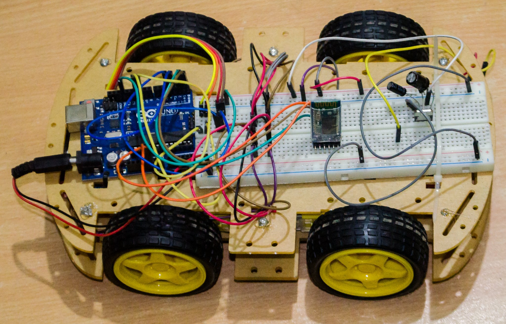
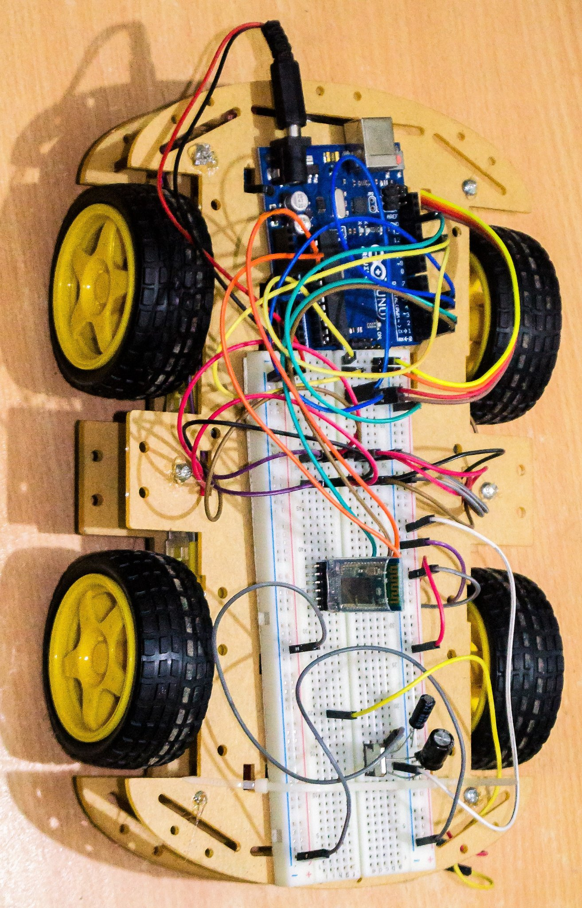
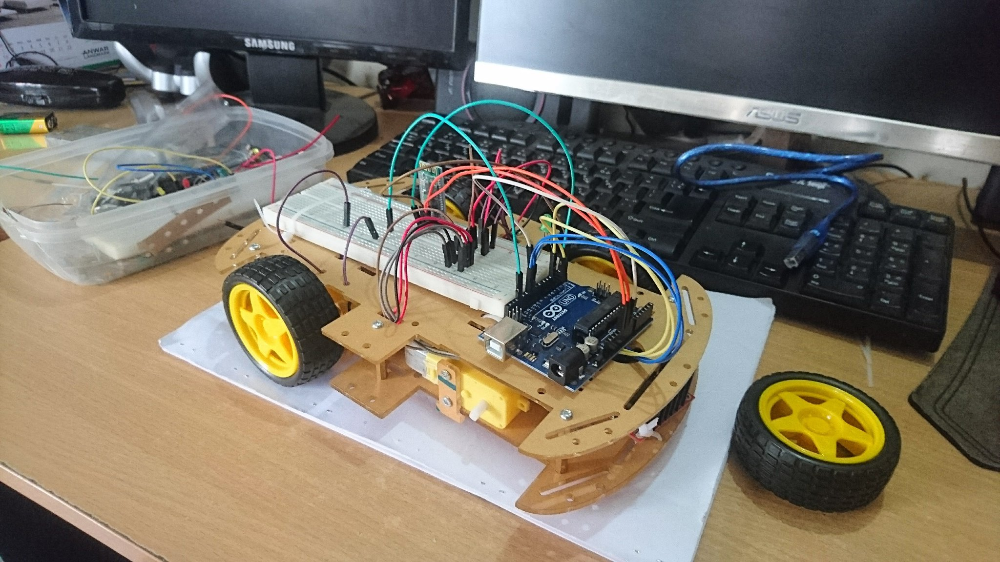
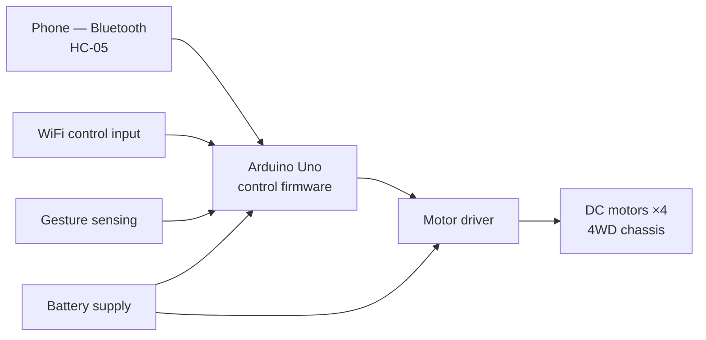

# Bluetooth / WiFi / Gesture-Controlled Robotic Car

B.Sc. project, American International University-Bangladesh (AIUB). A microcontroller robotic car with three independent control paths, built and integrated as one physical system.

# Overview

A motor-driven robotic car on a 4WD acrylic chassis, controlled three ways: from a phone over Bluetooth, over WiFi, and by hand gestures. The project is a systems-integration exercise: three different input paths converging on one actuation path (motor driver and DC motors), with power, wiring, and firmware treated as one build.

# Problem Statement

Integrate commodity modules (microcontroller, Bluetooth, WiFi, gesture sensing, motor driver, battery power) into a single controllable vehicle, with each control mode working end to end and the system behaving predictably when modes change.

# Objectives

1. Select and wire a complete hardware stack: compute, communications, sensing, actuation, power.
2. Write control firmware handling three input modes.
3. Bring the system up on the bench and debug it as an integrated whole, not as separate modules.

# Hardware Setup

Named to the level this repository's own build photos evidence:

- Arduino Uno (controller)
- 4WD acrylic chassis, DC motors, motor driver
- HC-05 Bluetooth module (visible centre-board in the build photos)
- WiFi module
- Gesture sensing input
- Battery power supply
- Breadboard prototyping during bring-up

# Software Setup

Embedded firmware for the Uno: command handling for the three control modes, motor drive outputs (direction and speed) via the motor driver.

# Architecture

# Methodology

Subsystem-first bring-up, then integration: motors and driver verified standalone, then each control path connected and tested in turn, then the complete system driven under each mode. The build photos in this repository are from the bench phase (chassis, motors, and Uno going together, breadboard prototyping).

# Test Matrix

| Item | Scope | Outcome |
|---|---|---|
| Motor/driver function | Bench, standalone | Verified during bring-up |
| Bluetooth control | Phone → HC-05 → drive commands | Working |
| WiFi control | Network input → drive commands | Working |
| Gesture control | Gesture input → drive commands | Working |
| Integrated system | Full vehicle driven under each mode | Working |

# Investigation Process

Bring-up debugging across the integration boundary: wiring, power, and module communication issues surface only when subsystems are combined, and were isolated by reverting to the last working subsystem configuration and re-adding one element at a time.

# Evidence

- Build photos (3, this repository): top view, wiring detail, mid-build bench state.

# Results

A completed, drivable vehicle controllable by Bluetooth, WiFi, and gesture input. The deliverable was the integrated system and its firmware; the design and build are documented here.

# Root Cause Analysis

No single fault investigation is documented for this project. Integration debugging followed the standard pattern (isolate to subsystem, verify, reintegrate); specific fault records were not preserved, and none are reconstructed here.

# Limitations

- Firmware source is not preserved (kept on a university lab machine). This repository is the documentation and photographic record.
- No quantitative test data (range, latency, battery life) was recorded at the time; none is claimed now.

# Lessons Learned

- Integration is a separate engineering activity from making each module work; budget time for it explicitly.
- Photograph builds as you go. For this project, the photos are now the primary evidence the work happened as described.

# Future Work

- Rebuild the firmware as a small documented codebase with a mode-arbitration rule stated in code (which input wins when two are active).
- Add a wiring diagram drawn from the build photos.

## Repository note

This repository holds the project documentation. The original source code was kept on a university lab machine and is not preserved; the design, hardware, and results are documented here.
